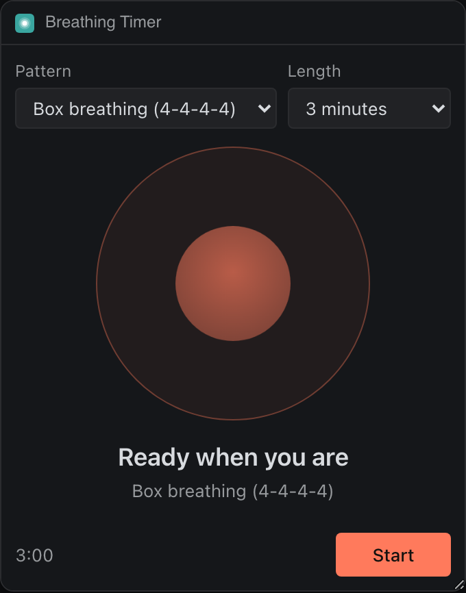
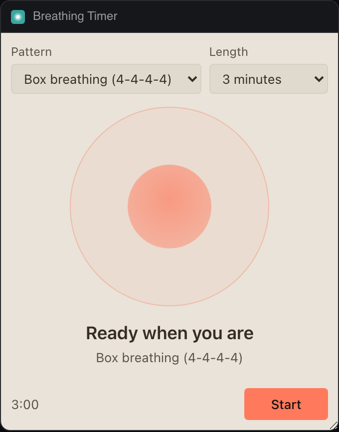

# Breathing Timer

A calm guide for box breathing, 4-7-8 and slow breaths. The orb fills as you breathe in and empties as you breathe out, and the session keeps time in Extras.




## What it teaches

- **One page for two places.** `contributes.extras` names no `view`, so Extras opens `index.html` too; `app.js` reads `init.place` and tightens the layout for the popover.
- **A session stored as timestamps.** `session.js` keeps `startedAt`, `pausedAt` and `pausedMs`, so the desk panel, the Extras view and a reload all work out the same breath from the clock without talking to each other.
- **Extras in practice.** `syncExtras()` sets `until` so Deska counts down with no frame alive, `progress` in 2% steps, and a `pause`, `play` or `start` control; `deska.on('extras.control')` answers it. Calls go out only when something visible changed.
- **Motion that respects `prefers-reduced-motion`.** The orb stops growing, and a plain bar and the count carry the rhythm. The loop runs on animation frames only while the panel is visible.
- **Sound only after a click.** The closing chime's `AudioContext` is made on Start, the one moment the browser allows it.

## Permissions and hosts

None.

## Try it

```sh
npm run preview -- panels/breathing-timer
```

Then in Deska: Panel Library, Build a panel, Load a folder, and pick `panels/breathing-timer`.

## Notes

- Space starts and pauses; Escape ends the session.
- The scope is `global`: one per project, since two guides breathing at once help nobody.
- Screen readers hear each phase once ("Breathe in"), not every second.
