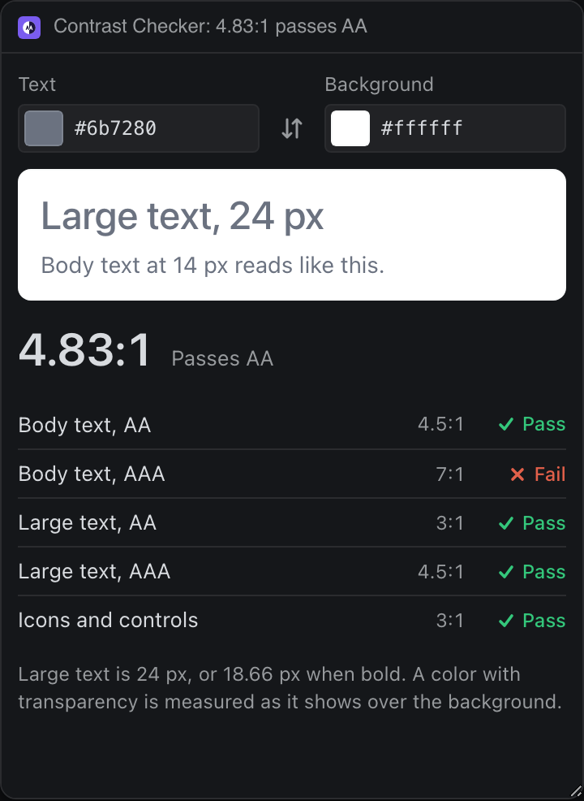

# Contrast Checker

Check a text color against a background with WCAG 2 contrast levels, see a live sample, and get the nearest text color that passes AA.




## What it teaches

- **Showing the person's colors without leaving the theme.** Only the sample box takes their colors; the rest of the panel stays on Deska's tokens.
- **Status that does not lean on color.** Every level says Pass or Fail in words, with an icon, as well as in green or red.
- **Letting the browser parse.** `parseColor()` in `color.js` hands any CSS color (`#abc`, `rgb()`, `hsl()`, `oklch()`, names) to a 1 by 1 canvas, so the panel understands exactly what CSS does.
- **Honest rounding.** WCAG compares without rounding up, so `formatRatio()` cuts to two decimals: 4.499 shows as 4.49 and fails.
- **A suggestion, not a lecture.** `nearestPassing()` mixes the text color toward black or white, which keeps its hue, and picks the smallest change that reaches 4.5:1.

## Permissions and hosts

None.

## Try it

```sh
npm run preview -- panels/contrast-checker
```

Then in Deska: Panel Library, Build a panel, Load a folder, and pick `panels/contrast-checker`.

## Notes

- A translucent text color is measured as it shows over the background; a translucent background is measured over white, and the panel says so.
- This is WCAG 2's ratio. APCA, proposed for WCAG 3, measures differently and is not here.
