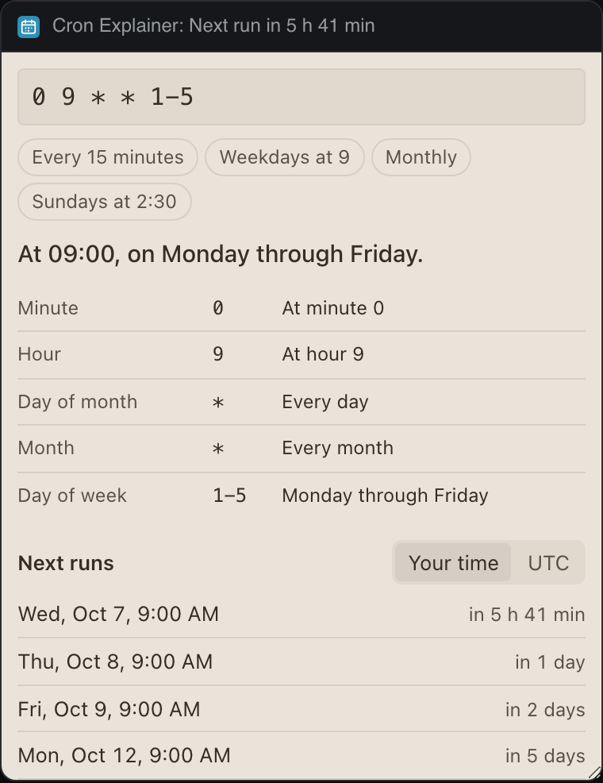

# Cron Explainer

Paste a cron expression and read it in plain words, field by field, with its next five runs in your time zone or in UTC.




## What it teaches

- **A live title.** `renderRuns()` sets "Next run in 2 h 5 min" under the panel's name, refreshed on the minute and only while the panel is visible.
- **Validation that says what to change.** `parseCron()` in `cron.js` throws a `CronError` with a sentence ("This has 6 fields. Standard cron has 5..."), never just "invalid".
- **`init.locale` for dates**, and a time zone switch kept in storage.
- **Fast next runs.** `nextRuns()` skips whole days and hours that cannot match and gives up after five years, so `0 0 31 2 *` says it never runs instead of spinning.

## Permissions and hosts

None.

## Try it

```sh
npm run preview -- panels/cron-explainer
```

Then in Deska: Panel Library, Build a panel, Load a folder, and pick `panels/cron-explainer`.

## Notes

- Five fields, as in crontab: lists, ranges, steps, month and day names, `7` for Sunday, and the `@hourly`, `@daily`, `@weekly`, `@monthly` and `@yearly` shortcuts.
- When both day of month and day of week are set, a day matching either one runs, as classic cron does. The words say "or".
- Six-field (Quartz, with seconds) and `L`, `W` or `#` forms are not read; the panel says so.
