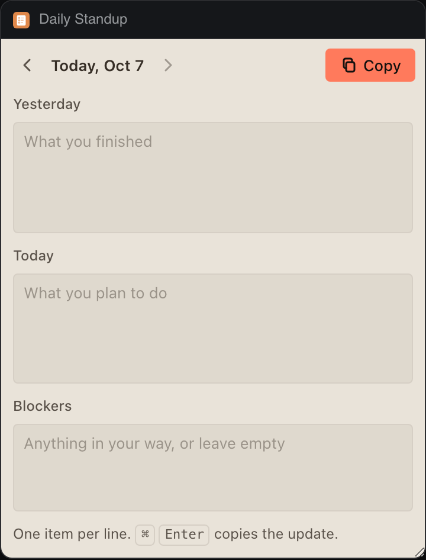

# Daily Standup

Yesterday, today and blockers, one note per day. Bring yesterday's plan forward, then copy the update as Markdown for your team chat.




## What it teaches

- **Saving while the person types.** `edited()` in `app.js` updates the document and calls a debounced `save()`; the panel flushes it the moment `deska.on('visibility')` says it is hidden and on `pagehide`, since a panel can reload at any time. A refused save keeps the edit pending and says why.
- **`clipboard.write` from a click or a shortcut.** `copy()` runs from the Copy button or Cmd+Enter (Ctrl+Enter elsewhere), and `copyText()` in `kit.js` turns `not_focused`, `too_large` and `permission_denied` into sentences.
- **Dated documents in storage.** `notes.js` keeps every day under one key as `{ version: 1, days: { 'YYYY-MM-DD': note } }`, drops empty days and anything older than 60 days in `compact()`, and refuses to overwrite data a newer version wrote.
- **Pure logic apart from the bridge.** `notes.js` has no DOM and no `deska` calls: `toMarkdown()`, `bullets()` and `previousPlan()` read and test on their own.

## Permissions and hosts

- `clipboard-write`: copying the update is the point of the panel.
- No network hosts. Notes stay in this panel's storage on this computer.

## Try it

```sh
npm run preview -- panels/daily-standup
```

Then in Deska: Panel Library, Build a panel, Load a folder, and pick `panels/daily-standup`.

## Notes

- One line is one item. A line that already starts with `-`, `*` or `1.` keeps its own marker.
- An empty Blockers section copies as "None".
- The arrows walk back through earlier days; there is no going past today.
