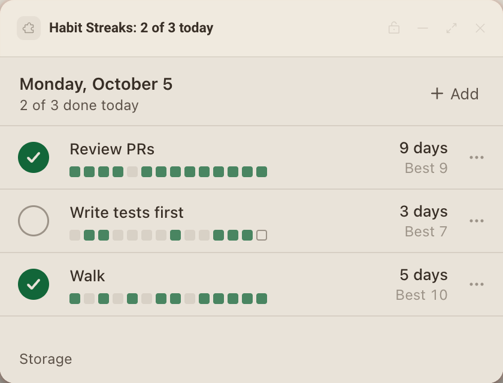

# Habit Streaks

Check off a few daily habits, keep your current and best streaks, and see the last two weeks at a glance.




## What it teaches

- **Storage as a small database.** Everything lives in one versioned document under one key, `habits`: `{ version, since, habits, days }`. One change is one write, so it lands whole or not at all (`app.js`, `read` and `write`).
- **Migrating on load.** Version 1 kept every check as an ISO timestamp on the habit; version 2 keys a compact map by local date. `migrate` in `habits.js` walks any older document forward one step at a time, and `read` saves the upgraded shape once. A document from a newer release is left untouched and the panel says so, instead of overwriting fields it cannot see.
- **Staying far under 256 KB.** `compact` in `habits.js` folds days older than 400 into each habit's `before` totals (the run reaching the cutoff and the best run before it), so streaks of any length survive while the stored history stays around 15 KB a year.
- **Handling `storage_full`.** When a write is refused, `write` folds history down to 60 days and tries once more; if that still does not fit, the change is not saved, no undo is offered, and the error line offers Try again.
- **One storage for every copy.** Every frame of a package shares the same keys, so each change reads fresh, changes, then writes (`change`), changes run one at a time, and a copy re-reads when it is shown again or gets focus (`refresh` and the `visibility` listener). Undo restores one habit on one day, so a change made meanwhile in another copy survives.
- **`storage.keys()`** lists what the package keeps, with sizes, under Storage (`renderStorage`).
- **`setTitle`** shows "2 of 3 today" under the panel's name on the canvas (`updateTitle`). It refuses an empty title, so with nothing to count the panel sets its own name.
- **Local days.** Dates are local calendar days; arithmetic runs on day numbers so daylight saving never skips or repeats a date, and a timer re-arms for the next local midnight so the panel rolls over while it stays open (`rollDay`).

## Permissions and hosts

None. The panel only uses `deska.storage` and `deska.setTitle`, which need no permission, and it never goes online.

## Try it

```sh
npm run preview -- panels/habit-streaks
```

Then in Deska: Panel Library, Build a panel, Load a folder, and pick `panels/habit-streaks`.

## Notes

- The first run writes three demo habits with about ten weeks of history so a new panel shows what it does. It is all in `seed.js`; delete that file and its one call in `app.js` to start empty.
- Habits are archived, not deleted, so their history and streaks come back on Restore.
- Undo covers the last check and lasts eight seconds, or press Cmd+Z (Ctrl+Z).
- Storage is per computer: the same package on another computer keeps its own habits.
