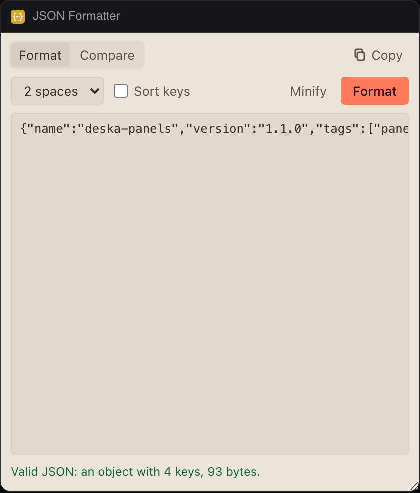

# JSON Formatter

Format, minify and sort JSON, find the exact line and column of a syntax error, and compare two documents key by key.




## What it teaches

- **Errors that help.** `JSON.parse` words its errors differently across versions and sometimes gives no position, so `locate()` in `json.js` walks the text by JSON's grammar and returns the offset and a plain reason ("Remove the comma before ]: JSON allows no trailing comma"). "Show me" selects the spot.
- **Editing a textarea so Undo still works.** `replaceText()` in `app.js` uses `execCommand('insertText')` rather than setting `.value`, so Cmd+Z brings back what you pasted.
- **Keeping storage small.** Inputs over 60,000 characters stay on screen but are not saved, and the panel says so once instead of failing on every keystroke.
- **A structural diff.** `diff()` compares objects key by key and arrays item by item, and Copy differences writes them as `+`, `-` and `~` lines.

## Permissions and hosts

- `clipboard-write`: Copy writes the formatted JSON or the list of differences.
- No network hosts.

## Try it

```sh
npm run preview -- panels/json-tools
```

Then in Deska: Panel Library, Build a panel, Load a folder, and pick `panels/json-tools`.

## Notes

- Arrays are compared by position: an item inserted at the start shows as every later item changed.
- The diff lists at most 500 differences.
- Cmd+Enter (Ctrl+Enter elsewhere) formats, or compares in Compare.
