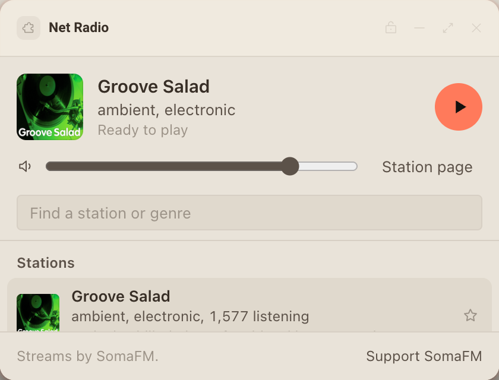
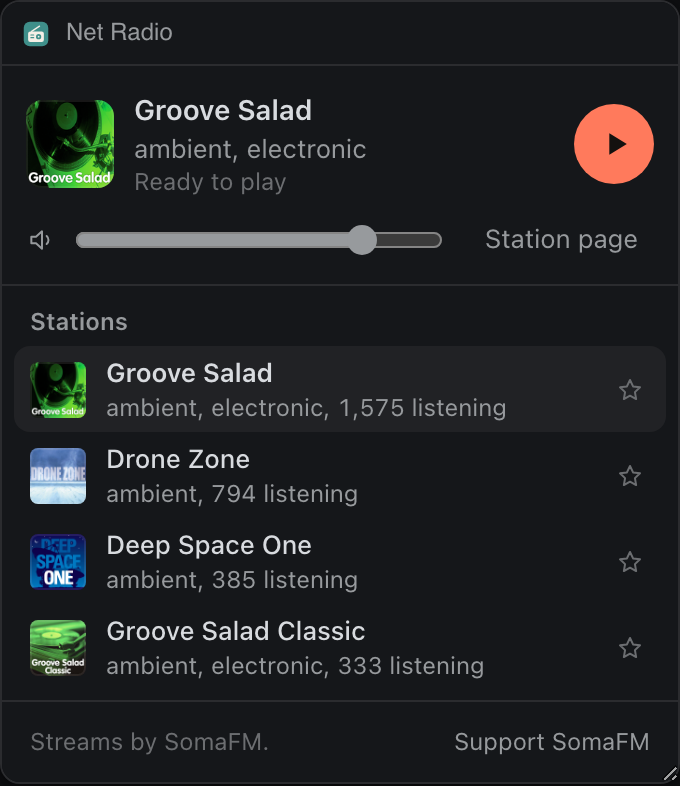
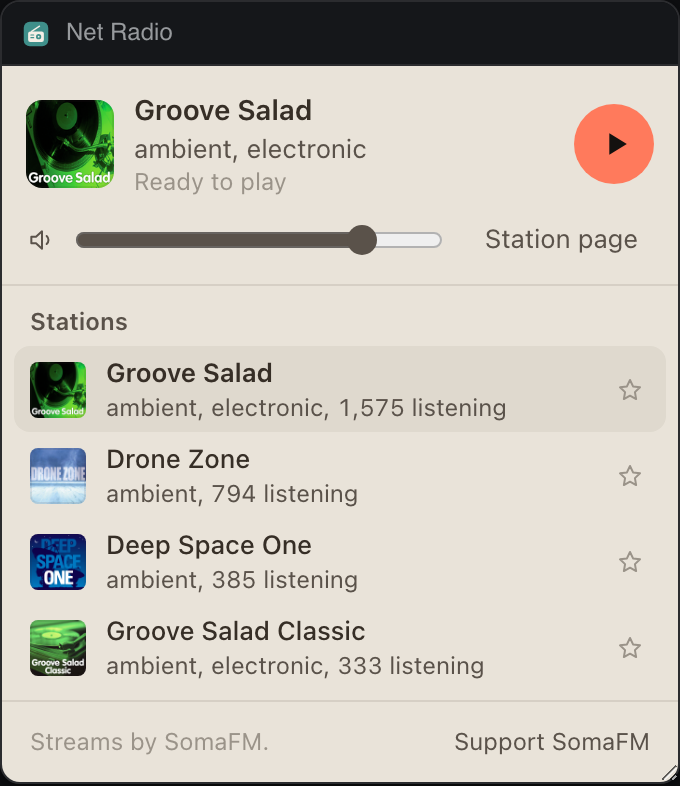

# Net Radio

Listen to SomaFM's listener supported internet radio while you work, with favorites and the track now playing.




Inside Extras it draws a compact layout:




## What it teaches

- Streaming audio from declared hosts: an `<audio>` element plays from any host listed in `network` (Deska's `media-src`), and needs no CORS headers. See `startStream` in `app.js` and `streamCandidates` in `somafm.js`, which reads the station's `.pls` playlist and keeps only declared hosts.
- The Extras place: `syncExtras` in `app.js` sets the row's state line and its round control (`pause` while playing, `play` while stopped), and `deska.on('extras.control', ...)` in `wire` plays or stops from that row, even when the panel is off screen.
- `deska.place`: `main` marks the page with `data-place`, and `app.css` hides the search and descriptions when the page opens inside the Extras popover.
- Visibility is not a reason to stop audio: `pollTrack` skips the cosmetic track lookup while `deska.visible` is false, and the music keeps playing.
- Designed playback states: `audio.play()` can be refused without a click (`NotAllowedError`), which shows a Play button instead of an error; buffering, a connection timeout that tries the next mirror, and a stream error with Try again.
- `deska.storage` for favorites, the last station (and whether it was playing), the volume, and a copy of the station list so the panel opens offline.
- `deska.setTitle` shows the station on the canvas while it plays. Deska refuses an empty title and text over 60 characters, so `syncTitle` sets the panel's own name back when the music stops, and `fit` shortens long station names.
- `deska.openUrl` for Support SomaFM and the station page, with `declined` and `not_focused` handled in `open`.

## Permissions and hosts

- `open-url`: opens SomaFM's support page and the current station's page in your browser.
- `api.somafm.com`: the station list (`channels.json`), each station's playlist, the recent songs (`songs/<id>.json`) and the station logos. All of it answers `Access-Control-Allow-Origin: *`.
- `ice1.somafm.com` to `ice6.somafm.com`: SomaFM's stream mirrors. The playlists name some of them and rotate over time, so all six are declared.

## Try it

```
npm run preview -- panels/net-radio
```

Then in Deska: Panel Library, Build a panel, Load a folder, and pick `panels/net-radio`.

## Notes

- SomaFM is independent and paid for by its listeners. This panel only links to their public streams for personal listening, credits them in its footer, and asks you to support them at somafm.com/support.
- The panel plays the MP3 stream of each station. SomaFM's stream servers refuse some automated clients (the user agent of headless Chrome gets a 403), so a scripted preview run needs a normal browser user agent.
- Stop disconnects the stream instead of pausing it: a live station has nothing to resume, and a paused stream would keep downloading.
- Only one Net Radio opens per project (`scope: global`), so two copies never play over each other.
- Closing the panel stops the music. The Extras row then offers Play, which opens the panel again.
