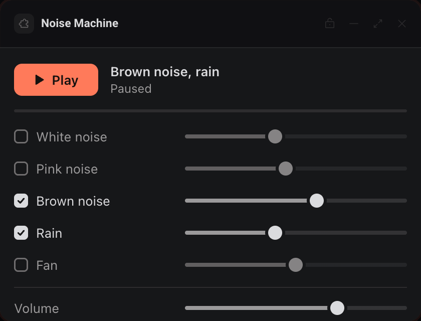
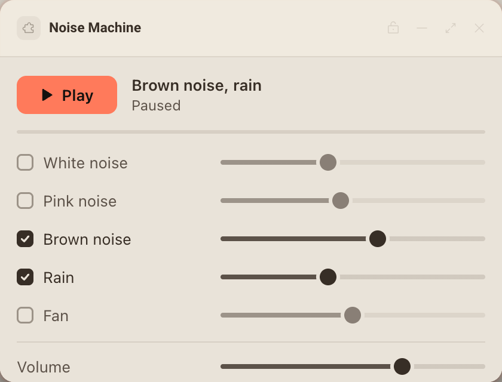
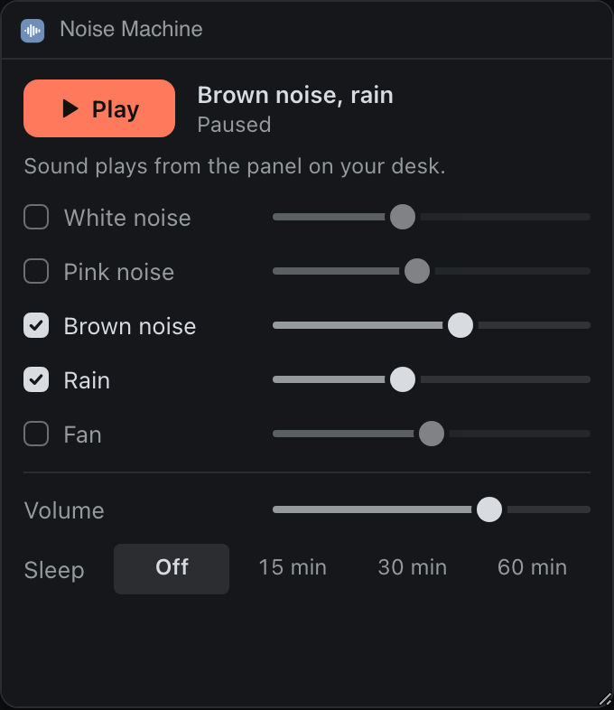
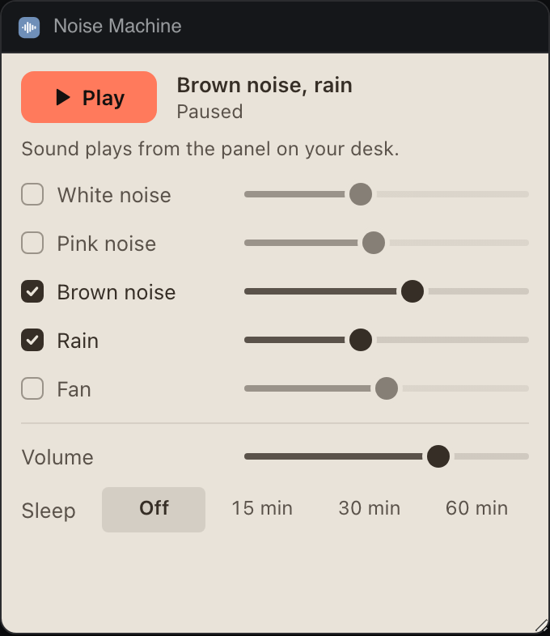

# Noise Machine

Focus sounds made live in the page with the Web Audio API: white, pink and brown noise, rain and a fan, mixed together with a sleep timer.






## What it teaches

- Audio with no network. `engine.js`, `createEngine()`, computes each noise color once into a looping buffer and shapes rain and the fan with filters, a hum and random drift. Nothing is fetched, so `network` stays empty and the panel works offline.
- Starting sound inside the sandbox. An `AudioContext` may start suspended until the person presses something in the frame. `app.js`, `onPlayPress()` creates and resumes it inside the press; `startSound()` notices when the browser keeps it blocked (after a reload, or from `extras.control`) and offers "Start sound".
- The Extras place. `publishExtras()` calls `deska.extras.set({ state, control, until })`: what plays, a play or pause control, and the sleep timer's end so Deska counts it down with no frame alive. `wireDeskaEvents()` answers `deska.on('extras.control')`. `start()` reads `deska.place === 'extras'` and switches to a compact layout.
- Visibility. A hidden frame keeps running, so the sound plays on while `deska.visible` is false, but `updateMeter()` stops drawing the level meter until the `visibility` event says someone can see it again. It also stays still under `prefers-reduced-motion`.
- Storage as shared state. The mix, master volume and sleep choice live in `deska.storage`, which every frame of the package shares. Each frame polls it in `sync()`, and `leadOrFollow()` keeps a short lease so only one frame (the speaker) makes sound, never the Extras popover and never two panels at once.

## Permissions and hosts

None. The sound is generated in the page, and nothing is opened, copied or announced.

## Try it

```sh
npm run preview -- panels/noise-machine
```

Then in Deska: Panel Library, Build a panel, Load a folder, and pick `panels/noise-machine`.

## Notes

- Sound plays from a panel on the desk. The Extras popover changes the mix and the row's button plays or pauses, but the popover closes with its frame, so it never plays sound itself.
- When a panel reloads (moved, docked, restarted), the sound stops with the old frame. The new one picks up within a few seconds and resumes if the browser allows audio without a press; otherwise it asks for one.
- The sleep timer fades out over its last minute on the audio clock, so the fade stays smooth even when page timers are slowed down.
- Two frames that write the mix at the same moment settle on the newest change; storage has no locks.
