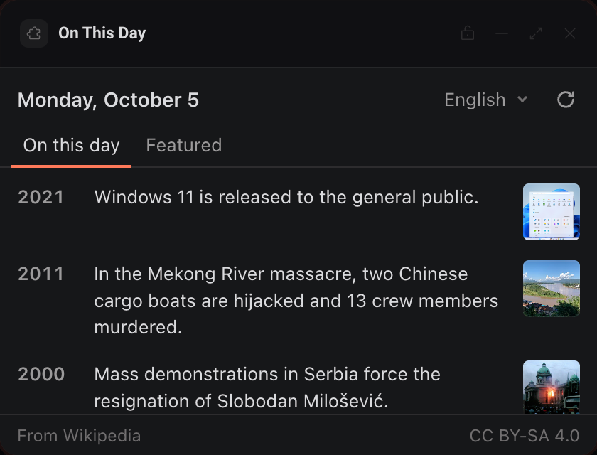

# On This Day

Today's events in history, the featured article and the picture of the day from Wikipedia, in the language you use.




## What it teaches

- **Reading the person's language from `init.locale`.** `start()` in `app.js` awaits `deska.ready()` and passes `init.locale` (for example `es-MX`) to `interfaceLocale()` in `i18n.js` for the panel's own words, and to `wikiLanguageFor()` in `wiki.js` for which Wikipedia to read. A language the panel has no words for falls back to English.
- **A tiny i18n dictionary.** `i18n.js` holds one table per language (English and Spanish). `translator()` returns `t(key, ...args)`, and any key a language lacks falls back to English. Words with numbers in them (`yearBc`, `by`) are small functions, so word order can differ per language.
- **Intl does the formatting.** `renderDate()` uses `Intl.DateTimeFormat`, so the heading reads "Monday, October 5" or "Lunes, 5 de octubre". `wireControls()` uses `Intl.DisplayNames` to let each language name itself in the switch ("Español", "Deutsch").
- **One declared host per language.** `HOSTS` in `wiki.js` maps each language to its Wikipedia, and every one of those hosts is in `panel.json` `network`. Deska builds the page's Content Security Policy from that list, and the policy takes exact host names, never `*.wikipedia.org`. Adding a language means adding a host, which the person sees before installing.
- **Images from declared hosts.** Thumbnails come from `upload.wikimedia.org` and `thumb.wikimedia.org`, which `network` puts under `img-src`. `image()` in `app.js` loads them with `loading="lazy"`, and a picture that fails is removed instead of showing a broken icon. `imageUrl()` in `wiki.js` drops any image URL on a host the panel did not declare.
- **`deska.storage` as a day cache.** `load()` saves the trimmed feed under `feed`; on reload `start()` paints it with no network when it is for today and the same language. `checkDay()` refetches when the calendar day changes, once a minute while visible and whenever `deska.on('visibility')` says the panel came back.
- **`deska.openUrl` with its errors.** `open()` handles `not_focused`, `declined`, `permission_denied` and `rate_limited` by their codes.

## Permissions and hosts

- `open-url`: opens articles, the picture's file page, Wikipedia's home page and the license in your browser.
- `en.wikipedia.org`, `es.wikipedia.org`, `fr.wikipedia.org`, `de.wikipedia.org`, `pt.wikipedia.org`, `it.wikipedia.org`: the daily feeds (`/api/rest_v1/feed/onthisday/events/MM/DD` and `/api/rest_v1/feed/featured/YYYY/MM/DD`) for each language the switch offers. They answer `Access-Control-Allow-Origin: *`, which is what lets the sandboxed frame read them.
- `upload.wikimedia.org`, `thumb.wikimedia.org`: the thumbnails and the picture of the day.

## Try it

```sh
npm run preview -- panels/on-this-day
```

Then in Deska: Panel Library, Build a panel, Load a folder, and pick `panels/on-this-day`.

## Notes

- **Attribution and license.** The event text, article extracts and descriptions are from Wikipedia and are licensed under [CC BY-SA 4.0](https://creativecommons.org/licenses/by-sa/4.0/). The panel credits them with a "From Wikipedia" link and a "CC BY-SA 4.0" link under every view. Each picture of the day carries its own author and license, shown under it. If you reuse this panel's output, keep the credit and the license.
- **API terms.** Wikimedia asks API clients to send a descriptive `User-Agent`. A page in a browser cannot set that header, so the panel keeps its traffic small instead: two requests per language per day, cached in `deska.storage`. See the [Wikimedia API etiquette](https://www.mediawiki.org/wiki/API:Etiquette).
- **Languages.** The switch offers English, Spanish, French, German, Portuguese and Italian. Japanese Wikipedia has no "on this day" feed, so it is left out. Spanish, French, Portuguese and Italian publish no featured article in the daily feed, so their Featured view shows only the picture.
- **Words.** The panel's interface is in English and Spanish. Other locales get English words and the Wikipedia of their language when the panel has its host.
- **Dates.** The day is the computer's local calendar day, so the feed changes at your midnight, not at UTC midnight.
