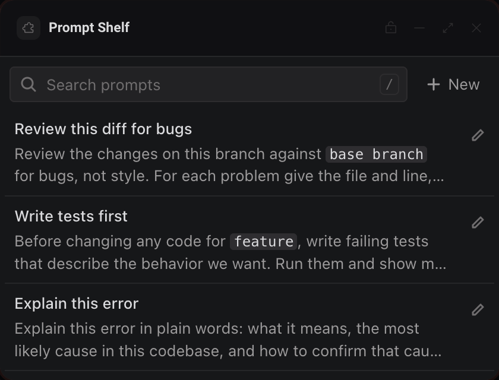

# Prompt Shelf

A small library of reusable prompts for coding agents: search it, fill in the blanks and copy a prompt in one click.




## What it teaches

- **Copying to the clipboard.** `copy()` in `app.js` calls `deska.clipboard.write` straight from the person's click or Enter, and `copyProblem()` turns each refusal into a clear message: `not_focused` (the frame lost focus), `too_large` (over 64 KB), `permission_denied` and `rate_limited`.
- **A collection in storage.** The whole shelf lives under one key as `{ version: 1, items: [...] }`. `readShelf()` in `shelf.js` seeds four prompts on the first run, reads version 1, and refuses data saved by a newer version instead of overwriting it. `save()` in `app.js` adopts the next shelf only after Deska accepts it, so a `storage_full` refusal keeps the editor open with everything the person typed.
- **Keyboard inside a sandboxed frame.** The `keydown` listener in `app.js` handles `/` and Cmd+F (search), arrow keys, Home and End (rows), Enter (copy) and Escape (close or clear). Focus only moves within the page, and only in answer to the person's own keys and clicks.
- **Blanks in a prompt.** `placeholders()` and `fill()` in `shelf.js` find `{{name}}` blanks; `renderFill()` in `app.js` asks for their values inline before copying.

## Permissions and hosts

- `clipboard-write`: copying a prompt is the panel's whole point.
- No network hosts. Everything stays in this panel's storage on this computer.

## Try it

```sh
npm run preview -- panels/prompt-shelf
```

Then in Deska: Panel Library, Build a panel, Load a folder, and pick `panels/prompt-shelf`.

## Notes

- Storage holds 256 KB per package, shared by every copy of this panel on the computer. When it is full, saving says so and keeps your edit; delete or shorten a prompt to make room.
- A prompt over 64 KB saves but cannot be copied from a panel.
- A blank left empty when copying stays in the text as `{{name}}`, so you can still see it.
- The panel works offline: it never makes a network request.
