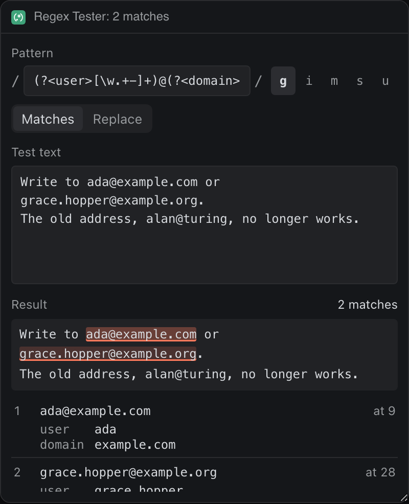

# Regex Tester

Try a JavaScript regular expression against your own text: matches marked as you type, every capture group by number and name, the five common flags, and a Replace mode.




## What it teaches

- **Heavy work with no workers.** The sandbox allows no workers, so `run()` in `app.js` times each run. Past 150 ms it stops testing on every keystroke and shows a Run button, so a pattern that backtracks badly cannot freeze typing. The panel runs in its own process, so only this panel ever waits.
- **Text built from DOM nodes.** `renderPreview()` and `renderList()` build marks and rows with `textContent`, never `innerHTML`, so the person's text can hold anything.
- **Errors in the engine's own words, tidied.** `compile()` in `regex.js` trims "Invalid regular expression: /(/:" down to the useful part and marks the field `aria-invalid`.
- **A whole form in one storage key**, written after typing pauses.

## Permissions and hosts

None. Everything runs in the panel; nothing leaves it.

## Try it

```sh
npm run preview -- panels/regex-tester
```

Then in Deska: Panel Library, Build a panel, Load a folder, and pick `panels/regex-tester`.

## Notes

- This is JavaScript's engine, so the syntax is JavaScript's: named groups are `(?<name>...)`, and lookbehind works.
- Without the `g` flag only the first match is found, as in your code; the count says so.
- The test text can be up to 100,000 characters, and the list shows the first 200 of up to 1,000 matches.
