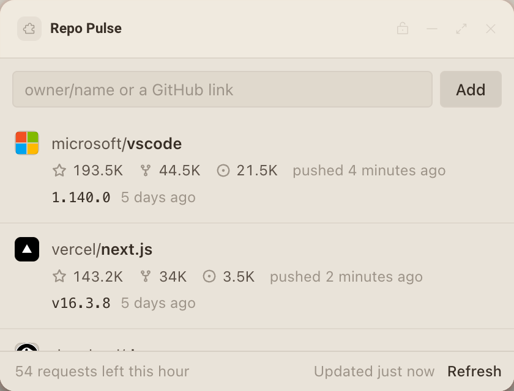

# Repo Pulse

Watch a few public GitHub repositories without signing in: stars, forks, open issues, the last push and the latest release, with a notification when a new release ships.




## What it teaches

- **Living within a public rate limit.** GitHub allows 60 unauthenticated requests an hour per network address. `github.js` `getJson()` sends every request with `If-None-Match` and the ETag saved in `deska.storage`, reads `X-RateLimit-Remaining` and `X-RateLimit-Reset` from every answer, and turns a 403 or 429 into `OutOfRequests`. `app.js` `interval()` spreads refreshes so they spend at most 30 requests an hour, and `schedule()` waits for the reset when the budget runs out. The footer says how many requests are left.
- **Refreshing only while someone can see it.** `schedule()` in `app.js` does nothing while `deska.visible` is false or `deska.idle` is true, and the `visibility` listener in `start()` catches up the moment the panel is seen again.
- **Notifying on a real transition, once.** `updateRelease()` only calls a release new when an earlier check saw a different one, and `refresh()` saves the cache before `announce()` calls `deska.notify`, so a reload never repeats it. Several releases found together make one notice, and a `rate_limited` answer waits out the 10 seconds once.
- **Links and images from declared hosts.** `open()` calls `deska.openUrl` straight from a click (it needs frame focus) and handles `not_focused` and `declined`. `avatarFor()` loads owner avatars from `avatars.githubusercontent.com`, the second host in `network`, which is what puts it in the page's `img-src`.

## Permissions and hosts

- `notify`: tells you when a watched repository publishes a new release.
- `open-url`: opens a repository or a release in your browser when you click it.
- `api.github.com`: the public REST API for repository numbers and releases. It answers with `Access-Control-Allow-Origin: *`, which a panel's opaque origin needs.
- `avatars.githubusercontent.com`: the owner avatars beside each name.

## Try it

```sh
npm run preview -- panels/repo-pulse
```

Then in Deska: Panel Library, Build a panel, Load a folder, and pick `panels/repo-pulse`.

## Notes

- **No token, on purpose.** A token would raise the limit to 5,000 an hour, but a panel has nowhere safe to keep one: `deska.storage` is plain JSON on disk that every copy of the package reads, and anything typed into the page lives in its memory. So the panel only reads public data and stays inside the anonymous limit.
- **ETags save bytes, not requests.** GitHub documents that a 304 answer does not count against the limit when the request is authorized. Unauthenticated, a 304 still counts (measured in October 2026), so the panel budgets every request, 304s included. The conditional requests still keep answers small and tell the panel nothing changed without parsing anything.
- The 60 requests are shared by everything on your network address, so the count in the footer can drop by more than this panel spent.
- A repository with no releases answers `releases/latest` with a 404, which carries no ETag, so it costs a full request on every refresh. The browser also logs that 404 in the console; it is expected.
- Up to 12 repositories, so a full refresh (two requests each) still fits the budget. With 3 it refreshes every 12 minutes, with 12 every 48.
- Data comes from the [GitHub REST API](https://docs.github.com/en/rest) under the [GitHub Terms of Service](https://docs.github.com/en/site-policy/github-terms/github-terms-of-service). Avatars belong to their owners.
