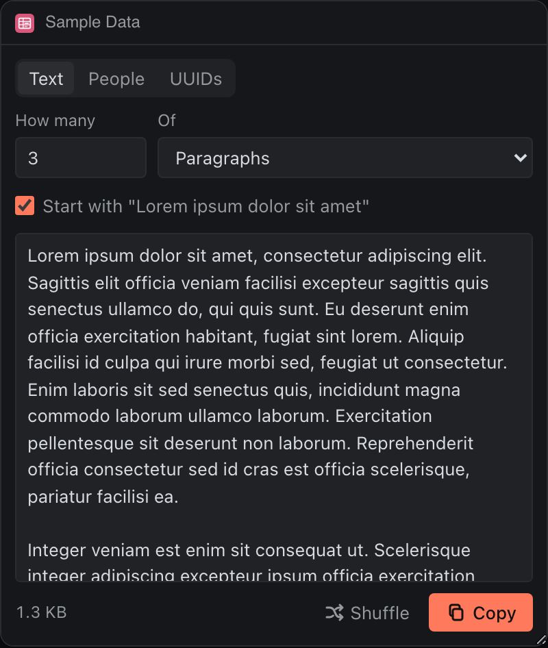

# Sample Data

Placeholder text, fake people and UUIDs as JSON, CSV or a Markdown table, ready to paste into a mockup, a fixture or a test.




## What it teaches

- **Seeded output.** `generate.js` draws everything from a small seeded generator. The seed is saved, so a reload shows the same data, and Shuffle is just a new number.
- **The 64 KB clipboard limit.** The panel measures what it would copy and shows the size under the output, so it says "over the 64 KB Deska copies" before Deska refuses with `too_large`.
- **A number field validated on change**, with the error tied to the field by `aria-describedby`.
- **Safe fake data.** Emails use `example.com`, which is reserved for examples, and phone numbers sit in the 555-0100 to 555-0199 range set aside for fiction.

## Permissions and hosts

- `clipboard-write`: Copy writes the output.
- No network hosts.

## Try it

```sh
npm run preview -- panels/sample-data
```

Then in Deska: Panel Library, Build a panel, Load a folder, and pick `panels/sample-data`.

## Notes

- Up to 50 paragraphs, 200 sentences, 2,000 words, or 500 people or UUIDs at once.
- The UUIDs are well-formed version 4 but come from a seeded generator: fine for fixtures, not for anything that must be unique or secret.
