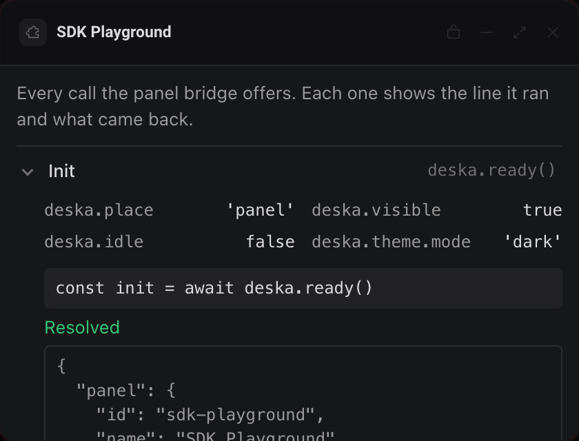
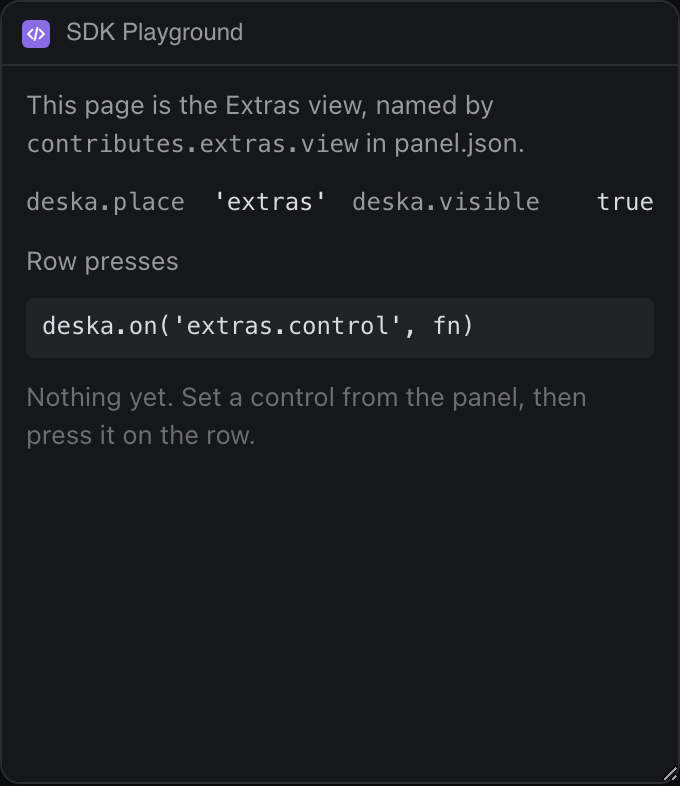
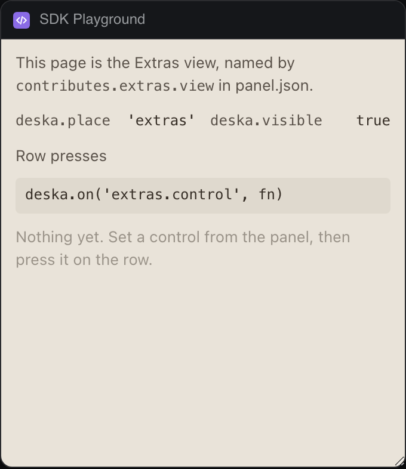

# SDK Playground

Every call of the panel bridge behind a small form, with the line of code it ran, what Deska answered, and what each error code means.




The Extras view:




## What it teaches

- **Starting up.** `app.js`, `boot()`: await `deska.ready()` before anything else and show the init payload; `renderLive()` reads `deska.place`, `deska.visible`, `deska.idle` and `deska.theme` as live fields.
- **Every method, wired the same way.** `app.js`, the `wire*` functions: storage (`get`, `set`, `remove`, `keys`), `setTitle`, `notify`, `openUrl`, `clipboard.write` and `extras.set`.
- **Reading refusals.** `call.js`, `run()`: the SDK rejects with an `Error` whose `code` is the bridge code; `errors.js` says what each of the ten codes means. The Notify section counts down the 10 s limit after `rate_limited`.
- **Surviving a reload.** `app.js`, `restoreOpenSections()`: which sections are open lives in `deska.storage` under `playground.open`, so a move or a dock keeps the layout.
- **Events and Extras.** `app.js`, `wireEvents()`, and `events.js`, `answerControl()`: listen with `deska.on()`, and answer a press on the Extras row so every open frame gives the same answer. `extras.html` and `extras.js` are the page Deska shows inside Extras.

## Permissions and hosts

- `notify`: the Notify section sends a notice.
- `open-url`: the Open URL section opens a link in the browser.
- `clipboard-write`: the Clipboard section writes text, and the too_large trigger shows the 64 KB limit.
- No hosts. The panel never reaches the network, so it works offline.

## Try it

```sh
npm run preview -- panels/sdk-playground
```

Then in Deska: Panel Library, Build a panel, Load a folder, and pick `panels/sdk-playground`.

## Notes

- The storage key `playground.open` shows up in Keys: it is the panel's own remembered layout.
- `not_ready` and `unknown_method` cannot be triggered through the SDK, which queues calls until ready and only offers methods Deska knows. `permission_denied` needs a manifest without the permission, and `storage_full` needs 256 KB of stored values; the Error codes section explains them instead.
- `openUrl` and `clipboard.write` need the panel to have focus, so they run from the click itself. Deska asks before opening each new host; Cancel answers `declined`.
- The title only shows on the canvas, not in a panel or dock window of its own.
