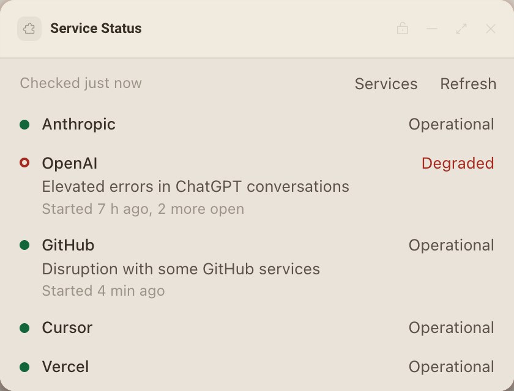
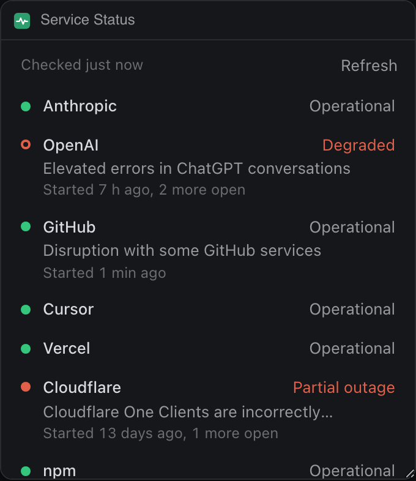
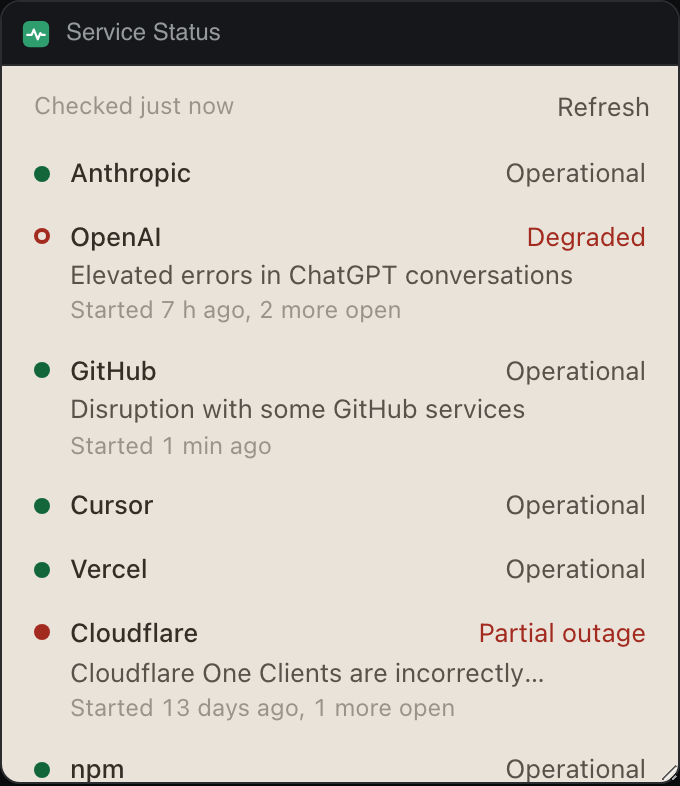

# Service Status

Shows whether Anthropic, OpenAI, GitHub, Cursor, Vercel, Cloudflare and npm are up, read from their public status pages.




In Extras:




Each row names the service and its overall state in words. When a service has an open incident, the row adds its name and how long ago it started. Click a row to open that service's status page. Services lets you pick which ones to watch.

## What it teaches

- Declaring `network` hosts and fetching them under the panel's CSP: `panel.json` lists the seven hosts, and `checkService` in `services.js` fetches one with a timeout and never throws, so one failing host only marks its own row as "Could not reach".
- Polling that follows visibility: `schedule` and the `deska.on('visibility')` handler in `app.js` check every 2 minutes while the panel is seen, every 10 minutes when it is hidden or the person is away, and at once when it is seen again after a gap. A reload within the interval reuses the stored check.
- Notifying only on a change: `announceTransitions` in `app.js` keeps what it last announced in `deska.storage`, so a reload or a second copy of the panel never repeats a notice. Every change from one check rides a single `deska.notify`, which also respects the limit of one notice every 10 seconds.
- `deska.extras.set({ state })` in `publishExtras`, with a short line such as "All systems normal" or "OpenAI degraded".
- `deska.openUrl` in `openPage`, called straight from the click, with a note for `declined`, `not_focused`, `rate_limited` and `permission_denied`.

## Permissions and hosts

- `notify`: tells you when a watched service starts having problems or recovers.
- `open-url`: opens a service's status page in your browser when you click its row.
- `status.claude.com`, `status.openai.com`, `www.githubstatus.com`, `status.cursor.com`, `www.vercel-status.com`, `www.cloudflarestatus.com`, `status.npmjs.org`: each one's `/api/v2/summary.json`, which answers any origin.

## Try it

```sh
npm run preview -- panels/service-status
```

Then in Deska: Panel Library, Build a panel, Load a folder, and pick `panels/service-status`.

## Notes

- Every page here is an Atlassian Statuspage. Its overall indicator maps to Operational (`none`), Degraded (`minor`), Partial outage (`major`), Major outage (`critical`) and Maintenance (`maintenance`). Statuspage calls `major` a partial system outage, so the panel does too.
- Status data belongs to each service and is shown as they publish it. The panel only reads public summaries and sends nothing.
- The first check after you add the panel sets a baseline: an outage already going on then does not notify.
- Cloudflare's summary is large (over 200 KB) because it lists every data center. Requests use `no-cache`, so an unchanged page is revalidated with its ETag rather than downloaded again.
