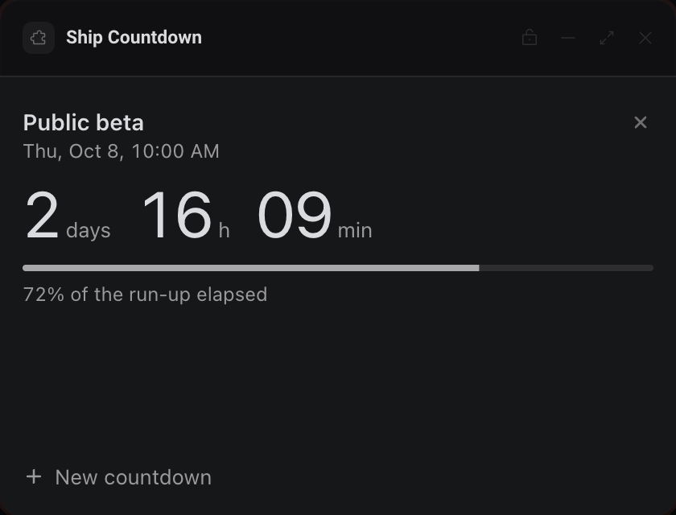
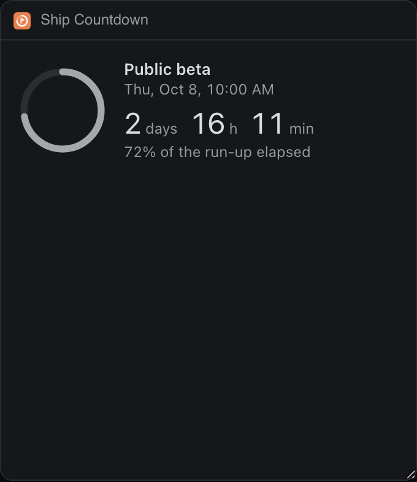
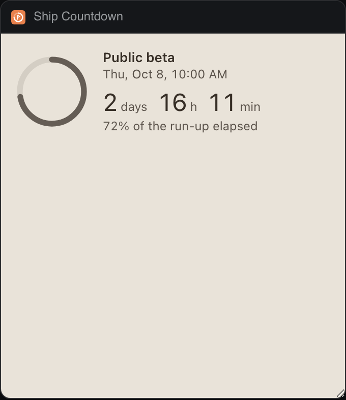

# Ship Countdown

Counts down to a launch, a demo or a deadline, and keeps the soonest one ticking in Extras.




The compact view Extras opens:




Give a countdown a name, a date and a time. Each one shows the days, hours and minutes left and how much of its run-up has gone by, measured from the moment you set it to the target. When one reaches zero you get a notification once, and the row turns into "Shipped 2 h ago".

## What it teaches

- **An Extras view of its own.** `panel.json` declares `contributes.extras` with `"view": "extras.html"`, so opening the row in Extras shows a compact page (`extras.html`, `extras.js`) instead of the full panel.
- **`deska.extras.set` with `until`.** `extrasFor()` in `countdowns.js` sends the soonest countdown as `state` (its name), `until` (its target time) and `progress` (the elapsed run-up, 0 to 1, drawn as a ring). Because Deska gets the target time rather than a string, it draws the time left and keeps counting by itself, even when no frame of this package is alive. The panel never has to stay open to keep Extras right.
- **Sending only what changed.** `syncExtras()` compares the fields with the last ones it sent, so a page that ticks every second makes a bridge call only when the row would change.
- **The round control.** A finished countdown nobody has dismissed takes the row with `control: 'stop'`; with nothing scheduled the row offers `'start'`. `deska.on('extras.control')` in `app.js` and `extras.js` answers them: stop dismisses the finished countdown (`dismissFinished()`), start opens the form.
- **Two pages, one storage.** `index.html` and `extras.html` are pages of the same package, so they read and write the same `deska.storage` key. They cannot message each other, so each one re-reads storage on its tick, and every change is load, change, save (`update()`), so one page never writes over the other's edit.
- **Notify once, across reloads.** `notifyFinished()` writes `notified: true` to storage before it calls `deska.notify`, so a reload or the other page stays quiet. On `rate_limited` (one notification every 10 s) it clears the flag and tries again after the window.
- **Visibility.** `schedule()` ticks on the second while the panel is on screen and every 15 s when Deska says it is hidden or the person is away.

## Permissions and hosts

- `notify`: to say "Launch day is here" when a countdown reaches zero.
- No network hosts. Everything lives in `deska.storage` on this computer.

## Try it

```sh
npm run preview -- panels/ship-countdown
```

Then in Deska: Panel Library, Build a panel, Load a folder, and pick `panels/ship-countdown`.

In the preview, switch Place to Extras to see the compact view, and use the Extras row's button to send the control.

## Notes

- The first run seeds one countdown, "Public beta", three days out, so the panel opens on something real. Remove it with its close button.
- Times are read in the computer's time zone, from the native date and time inputs. The form is handled in script (`preventDefault`), since the panel's policy blocks real form submissions.
- Both pages may notice a countdown reaching zero in the same second. Writing the flag first makes a second notification unlikely, not impossible; Deska's 10 s limit catches the rest.
- Removing a countdown happens at once, with no undo.
