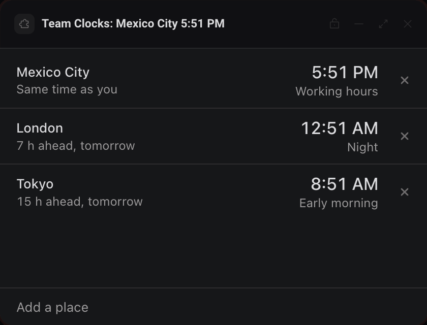

# Team Clocks

The local time of your teammates and cities, how far ahead or behind you they are, and whether it is a reasonable hour to reach them.




This is the smallest panel in the repo and the one to copy when you start your own. `app.js` reads top to bottom in five steps: wait for ready, apply the theme, load from storage, render, save.

## What it teaches

- **`deska.ready()` and the init payload**: `app.js`, step 1. The panel waits for Deska before touching the bridge, then formats every time with `init.locale` in `timeIn()`.
- **Theme tokens as CSS variables**: `app.js`, step 2, and all of `app.css`. The SDK writes the `--deska-*` tokens on `<html>` and keeps them current, so the panel never listens to `deska.on('theme')`.
- **`deska.storage.get` and `set`**: `load()` reads the list (a `null` means first run, which seeds three examples) and `save()` writes it after every add or remove, answering `storage_full` and `rate_limited` by their codes.
- **`deska.setTitle`**: `updateTitle()` puts the first place's time under the panel's name on the canvas, and clears it with `null` when the list is empty.
- **`deska.on('visibility')`**: `startClock()` and `stopClock()`. The clock ticks once a minute while the panel is visible and stops while it is hidden, catching up the moment it shows again.

## Permissions and hosts

None. The panel only reads the clock and keeps its list in `deska.storage`, so it asks for no permission and reaches no host.

## Try it

```
npm run preview -- panels/team-clocks
```

Then in Deska: Panel Library, Build a panel, Load a folder, and pick `panels/team-clocks`.

## Notes

- Time zones come from the browser's own `Intl` data (`Intl.supportedValuesOf('timeZone')`), so the list and its names follow the Chromium build Deska ships. Some zones use older names there, like `Asia/Calcutta` for Kolkata; typing either name works.
- You can type a zone (`Europe/Berlin`) or a city in the list (`berlin`). The label is optional and defaults to the city.
- Working hours are 9 to 18 on weekdays, evening until 22, night from 22 to 7. These are fixed, not taken from anyone's calendar.
- No network, so there is no offline state: the panel works the same with or without a connection.
