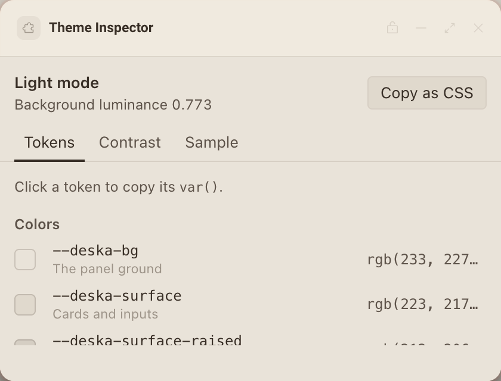

# Theme Inspector

A tool for panel creators that shows every theme token Deska sends, live, with contrast checks and a sample drawn only from tokens.




It has three views:

- **Tokens**: each color, font and radius with a swatch, its name and the resolved value. Click one to copy `var(--deska-…)`.
- **Contrast**: every text color measured on `--deska-bg` and `--deska-surface`, with the WCAG verdict in words (AAA, AA, Large only, Fails), plus `--deska-on-accent` on the accent.
- **Sample**: a small card with rows, an input and buttons, built only from tokens, so you can see how a well behaved panel looks in each theme.

Copy as CSS copies a `:root` block with every current value and the `color-scheme`, handy for designing outside Deska.

## What it teaches

- **The theme payload.** `app.js`, `main()`: `await deska.ready()` hands over the first theme (`init.theme`, also on `deska.theme`), and `deska.on('theme', fn)` sends it again on every theme or accent change. `render()` redraws from `{ mode, tokens }`.
- **Tokens are already CSS.** The SDK writes each token as a custom property on `<html>` and sets `color-scheme`, so `app.css` only ever says `var(--deska-…)`. The swatches in `renderColors()` are `var()` too; only the printed values come from the payload.
- **Contrast from resolved colors.** Deska sends solid colors (translucent ones are blended onto the panel ground first), so `color.js` computes the WCAG ratio straight from the value: `parseColor()` reads hex and `rgb()` and falls back to a canvas for anything else, then `luminance()` and `contrastRatio()`.
- **Designing for both modes.** The light theme's tertiary text and accent fail as body text on the ground; the Contrast view shows why they belong on hints and fills, not on paragraphs.
- **The clipboard, with its errors.** `copy()` and `copyError()`: `deska.clipboard.write` needs the permission and the frame's focus, and each refusal code (`not_focused`, `permission_denied`, `rate_limited`, `too_large`) gets its own message.
- **Coming back to the same place.** `saveView()` keeps the open view in `deska.storage`, because the panel reloads whenever it moves and `localStorage` throws in its sandbox.

## Permissions and hosts

- `clipboard-write`: to copy a token's `var()` or the whole `:root` block.
- No network hosts. Everything it shows comes from Deska.

## Try it

```sh
npm run preview -- panels/theme-inspector
```

Switch between the dark and light themes in the preview host and watch every value update. Then, in Deska: Panel Library, Build a panel, Load a folder, and pick `panels/theme-inspector`. Change the theme or the accent in Deska's appearance settings and the panel follows instantly.

## Notes

- The ratios use the WCAG 2 formula. AA needs 4.5 for body text and 3 for large text (24px, or about 19px bold); AAA needs 7.
- The mode line shows the ground's relative luminance. Deska calls a theme light when it is above 0.18.
- The values in the screenshots are the preview host's themes. Deska sends its own, and the accent follows the person's choice.
- If Deska ever sends a token this panel does not list, Copy as CSS still includes it.
