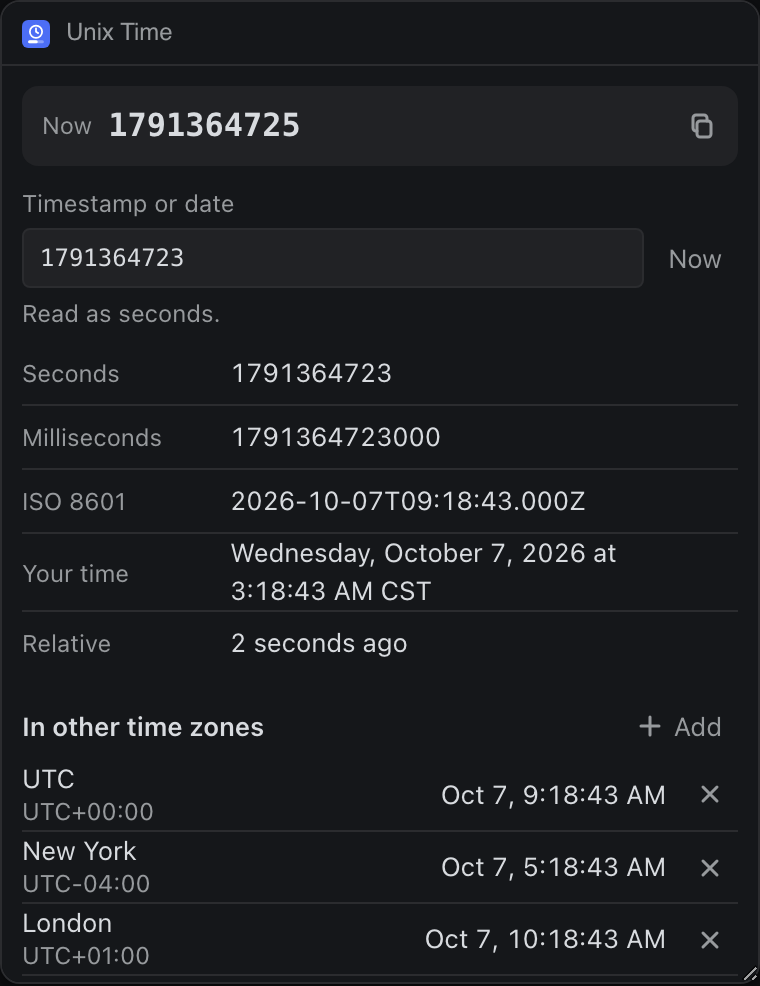

# Unix Time

Turn Unix timestamps into dates and dates into timestamps, in seconds or milliseconds, and see the same moment across the time zones you pick.




## What it teaches

- **A clock that only ticks while seen.** `tick()` in `app.js` updates the current Unix time every second, and stops when `deska.on('visibility')` says the panel is hidden.
- **One copy button per value**, each calling `clipboard.write` from its own click. On a pointer device the buttons show on hover and on keyboard focus.
- **Reading loose input kindly.** `readMoment()` in `time.js` reads digits by length (seconds, milliseconds, microseconds, nanoseconds) or a date, and the panel says how it read it: "Read as milliseconds".
- **Time zone names that changed.** `findZone()` accepts a city by its current name even when the browser's list carries an older one (Kolkata for Asia/Calcutta).

## Permissions and hosts

- `clipboard-write`: every value has a Copy button.
- No network hosts.

## Try it

```sh
npm run preview -- panels/unix-time
```

Then in Deska: Panel Library, Build a panel, Load a folder, and pick `panels/unix-time`.

## Notes

- A date with no time zone, like `2026-01-01T09:30`, is read in your time zone; a bare `2026-01-01` is midnight UTC, as JavaScript reads it. The panel says which.
- It keeps up to twelve extra time zones.
