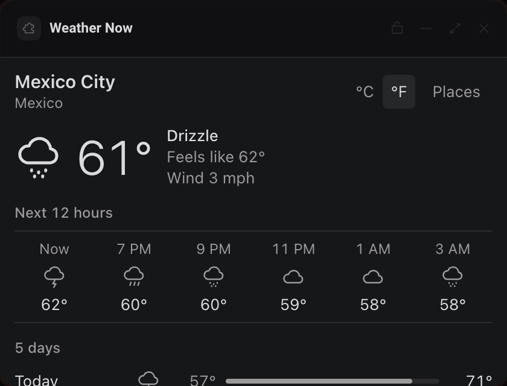
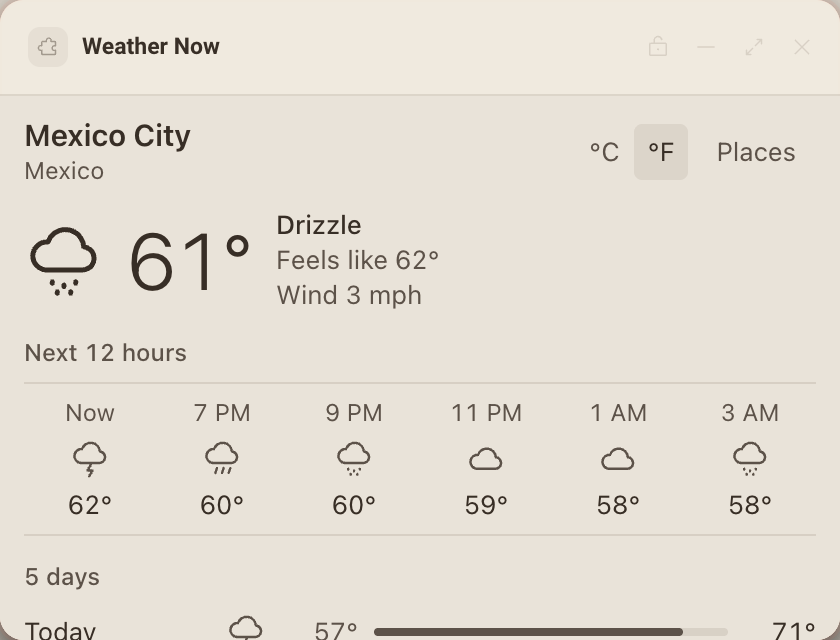

# Weather Now

Current weather, the next 12 hours and five days for the places you save, in the units your locale uses.




## What it teaches

- **`init.locale` and Intl.** `unitsForLocale()` in `app.js` reads the region from `init.locale` with `Intl.Locale(...).maximize()`: the United States gets °F and mph, everyone else °C and km/h. `makeFormatters()` keeps the copy in English but takes the hour cycle (17:00 or 5 PM) and the unit formats from the person's locale. A manual °C and °F choice is stored and wins from then on (`setUnits()`).
- **Forms in a sandboxed frame.** A panel's CSP has `form-action 'none'`, so a real submit is refused. `onSearchSubmit()` calls `preventDefault()` and picks the highlighted result itself.
- **Debounced search with AbortController.** `onQueryInput()` waits for a pause in typing, and `search()` aborts the request before it, so a slow earlier answer never replaces the results for what was typed last. The results are a keyboard listbox (`onQueryKey()`, `highlight()`).
- **Caching in `deska.storage`.** `showActive()` draws the last forecast from storage before asking the network, so a reload or an offline start shows weather at once with "Updated 20 minutes ago". `trimForecast()` keeps only what the panel draws, in °C and km/h, so the cache stays small and survives a unit change.
- **Opening a link.** `openAttribution()` calls `deska.openUrl()` from a click, and answers `declined`, `not_focused` and `rate_limited` by their code.
- **Inline SVG icons.** `weather.js` maps WMO weather codes to plain words and draws monochrome icons in `currentColor`, since remote images and icon fonts are refused.

## Permissions and hosts

- `open-url`: opens Open-Meteo's site from the attribution link.
- `api.open-meteo.com`: the forecast. It answers `Access-Control-Allow-Origin: *`, which a panel's opaque origin needs.
- `geocoding-api.open-meteo.com`: the city search. Same CORS answer, no key.

## Try it

```sh
npm run preview -- panels/weather-now
```

Then in Deska: Panel Library, Build a panel, Load a folder, and pick `panels/weather-now`.

## Notes

- Weather data by [Open-Meteo.com](https://open-meteo.com/), free for non-commercial use under CC BY 4.0. The panel shows the attribution link in its footer; keep it if you build on this panel. Commercial use needs one of Open-Meteo's paid plans.
- The first run seeds Mexico City so the panel opens on real weather. Remove it from Places like any other place.
- It keeps up to 10 places, with one cached forecast each. A forecast counts as fresh for 15 minutes and refreshes while the panel is visible.
- Forecast times are the place's own wall clock, not your computer's.
- Search needs a connection; the cached forecast does not.
