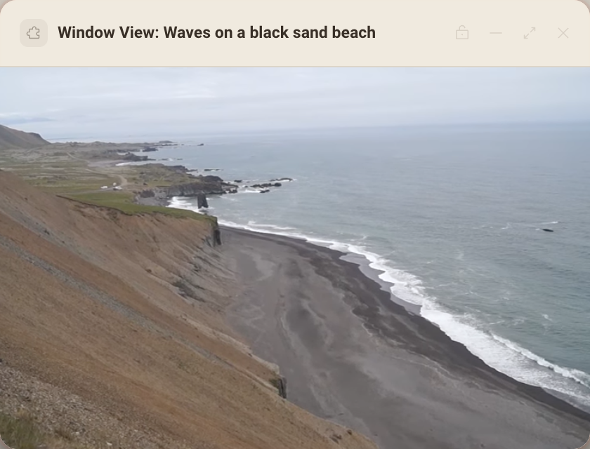

# Window View

A calm window on your desk: short looping nature scenes from Wikimedia Commons, muted, each with its credit.




## What it teaches

- **Pausing when nobody is looking.** `start()` in `app.js` reads `init.visibility` from `deska.ready()` before the first play, and `wire()` subscribes to `deska.on('visibility')`. `sync()` plays only while the panel is visible, the person is not idle and they have not paused it themselves. A frame keeps running off screen, so this is what saves CPU and battery.
- **Media from a declared host.** The `<video>` and its poster stream from `upload.wikimedia.org`, the one host in `panel.json` `network`. Deska's policy adds declared hosts to `media-src` and `img-src`; anything else is blocked.
- **Attribution done right.** `videos.json` keeps title, author, license and file page for every scene. The caption shows author and license, and `openCredit()` opens the file page with `deska.openUrl`, handling `not_focused`, `rate_limited` and `declined`.
- **A scene that will not load.** `onVideoError()` skips to the next scene in the direction the person was going, and shows a retry once every scene has failed. `deska.storage` brings back the same scene and pause choice after a reload (`save()`, `restore()`).

## Permissions and hosts

- `open-url`: the Credit button opens the scene's file page on Wikimedia Commons, where its full license lives.
- `upload.wikimedia.org`: the video files (480p VP9 WebM transcodes, about 1 to 3 MB each) and their poster frames.

## Try it

```sh
npm run preview -- panels/window-view
```

Then in Deska: Panel Library, Build a panel, Load a folder, and pick `panels/window-view`.

Hover the panel for the caption and controls. The left and right arrow keys change the scene and K pauses.

## Notes

- Every scene is from [Wikimedia Commons](https://commons.wikimedia.org) under CC0, CC BY or CC BY-SA. The list in `videos.json` was picked by hand through the Commons API; to add one, take its `480p.vp9.webm` transcode and copy the author and license from its file page.
- VP9 WebM plays in every Chromium build, including ones without proprietary codecs.
- With reduced motion turned on and no saved choice, the panel starts paused on the poster.
- The panel pauses when the network drops and picks up again when it returns.
